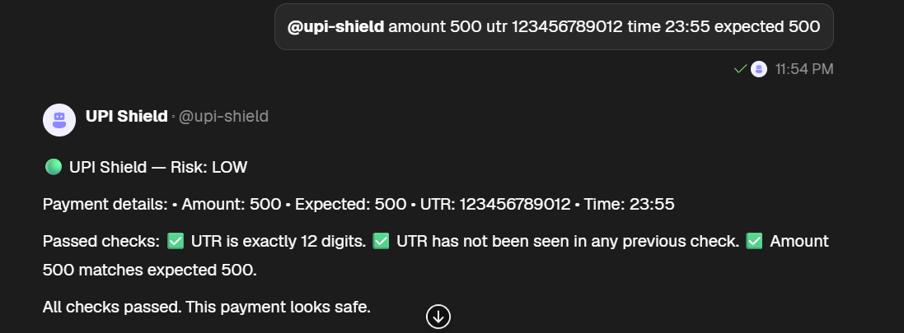
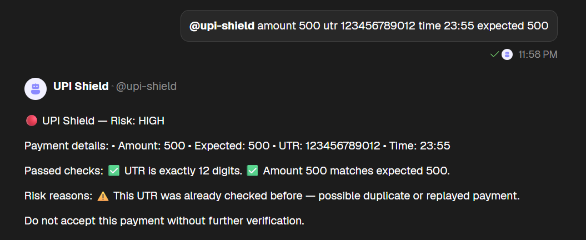
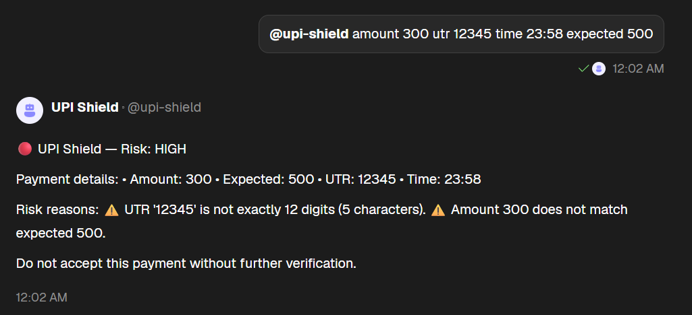

# UPI Shield 🛡️

**Fake UPI Payment Red-Flag Checker for Shopkeepers**

UPI Shield is a prototype that helps shopkeepers identify suspicious UPI payment claims by checking transaction details and detecting red flags such as invalid UTR formats, amount mismatches, and reused UTRs.

## 🚨 Problem Statement

Shopkeepers may receive fake UPI payment screenshots and hand over goods before confirming that the payment has arrived.

## 💡 Our Solution

UPI Shield checks the details provided by a shopkeeper and returns a risk verdict with clear reasons.

## ⚙️ How It Works

1. **Input:** The shopkeeper provides the payment amount, UTR, time, and expected amount.
2. **Validation:** The agent checks the UTR format and amount consistency.
3. **Duplicate Detection:** Previously checked UTRs can trigger a warning.
4. **Risk Verdict:** The agent returns LOW, MEDIUM, or HIGH risk with an explanation.

## 🤖 Agent Architecture

The project is designed around three roles:

- **OCR Agent:** Screenshot extraction is planned.
- **Validator Agent:** Performs the implemented payment-detail checks.
- **Fraud Network Agent:** Cross-shop fraud alerts are planned.

In the current prototype, these roles run within one hosted Agentverse agent rather than as three independently communicating agents.

## 🧰 Tech Stack

- Python
- Fetch.ai uAgents
- Agentverse
- Agent Chat Protocol

## 🧪 Example Input

`amount 500 utr 123456789012 time 23:55 expected 500`

A valid-format UTR with a matching amount may receive a LOW risk verdict. Reusing the same UTR can trigger a HIGH risk warning.

## ⚠️ Limitations

- UPI Shield does not verify actual bank transactions.
- Screenshot OCR is not yet implemented in the current prototype.
- Duplicate tracking is basic and is not yet a shared fraud database.
- A risk verdict is not proof of successful or failed payment.

Shopkeepers should confirm payments through their bank or official payment application.

## 🚀 Future Scope

- Screenshot OCR and vision-based extraction.
- Time-mismatch and image-edit detection.
- Independent agents communicating with each other.
- Shared fraud-alert storage.
- Potential WhatsApp access.

## 🔗 Live Agent

**Agent name:** `@upi-shield`

**Agent address:**

`agent1qv4a59gu9yvrdmdx7uwhnpuptd833c55az3pe7r9c7p6wu3m2gcxwfjl0ng`

## 👥 Team TriNetra

- Ayush Raj — DSEU
- Harshita Goyal — IGDTUW
- Sharyansh Gupta — DTU
- Anjali Singh — DSEU

## 📸 Screenshots

## 🔗 Links

- 📄 [Project deck (PDF)](UPI%20Shield%20-%20TriNetra.pdf)
- 🤖 [Live agent on Agentverse](https://agentverse.ai/agents/details/agent1qv4a59gu9yvrdmdx7uwhnpuptd833c55az3pe7r9c7p6wu3m2gcxwfjl0ng/profile)
- 💬 [Chat on ASI:One](https://asi1.ai)

**Event:** Fetch-A-Thon 3.0 — GCET Edition, Round 1.
